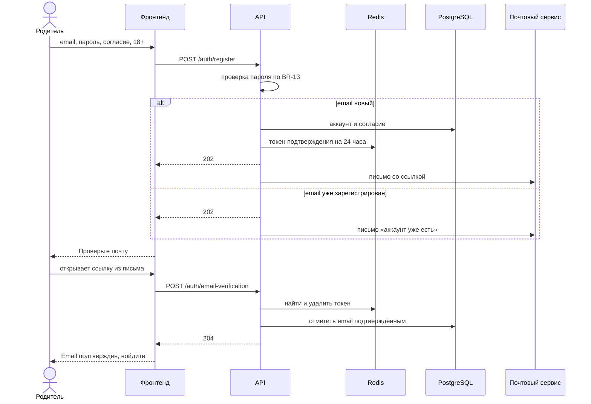
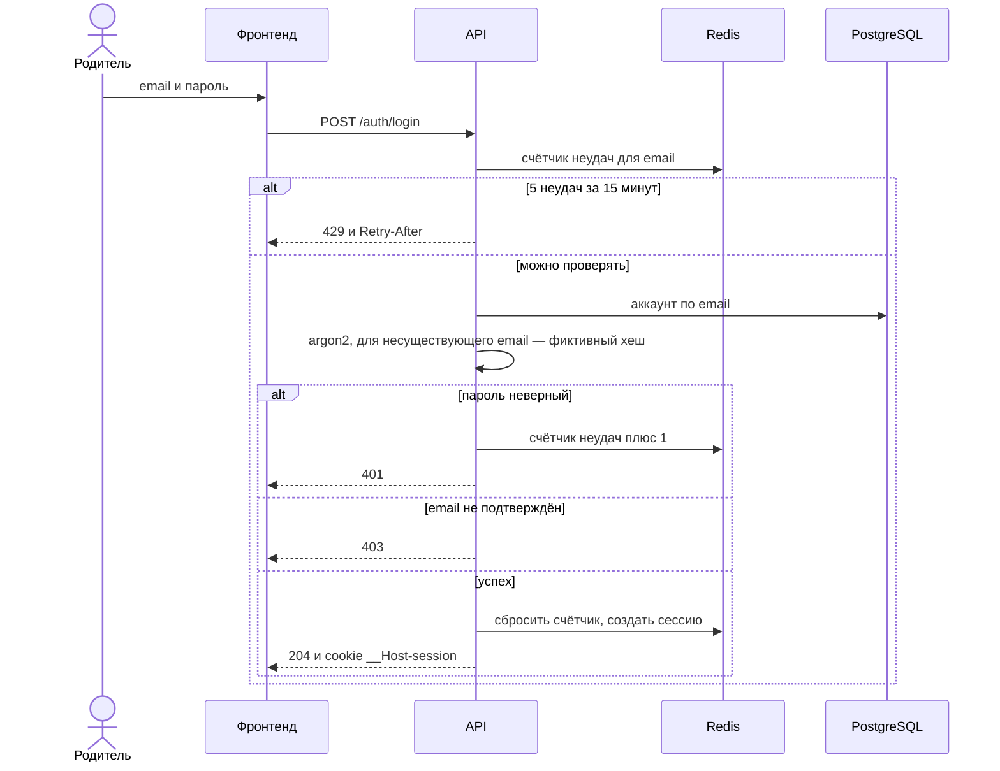
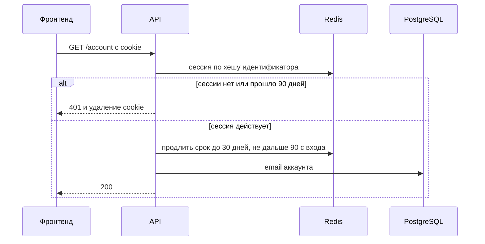
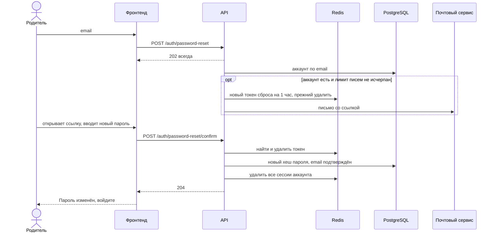

# Аккаунт родителя: проектирование

Связанные документы: [сценарии UC-07…UC-13](use-cases.md), [требования FR-40…FR-51](functional-requirements.md), [нефункциональные требования](non-functional-requirements.md), [модель C4](c4.md).

Вход — по email и паролю, сессия — в cookie, данные сессий и одноразовых ссылок — в Redis, аккаунты и согласия — в PostgreSQL. Требования к аутентификации и сессиям опираются на OWASP ASVS 5.0, главы V6 «Аутентификация» и V7 «Управление сессиями».

## Контракт API

Запросы и ответы — JSON, ошибки — Problem Details (RFC 9457). Если Redis или БД недоступны, эндпоинт отвечает 503.

| Метод и путь | Тело запроса | Назначение | Ответы | Требования |
|---|---|---|---|---|
| `POST /api/v1/auth/register` | `email`, `password`, `policy_version`, `consent`, `adult` | Регистрация | 202 всегда одинаковый, 422 — пароль не по правилам, нет согласия или версия политики устарела | FR-40, FR-41 |
| `POST /api/v1/auth/email-verification` | `token` | Подтверждение email | 204, 400 — ссылка недействительна | FR-42 |
| `POST /api/v1/auth/email-verification/resend` | `email` | Новое письмо подтверждения | 202 всегда | FR-41 |
| `POST /api/v1/auth/login` | `email`, `password` | Вход, ставит cookie сессии | 204, 401 — неверный email или пароль, 403 — email не подтверждён, 429 | FR-43 |
| `POST /api/v1/auth/logout` | — | Выход на этом устройстве | 204 | FR-44 |
| `POST /api/v1/auth/logout-all` | — | Выход на всех устройствах | 204, 401 | FR-45 |
| `POST /api/v1/auth/password-reset` | `email` | Ссылка для сброса пароля | 202 всегда | FR-46 |
| `POST /api/v1/auth/password-reset/confirm` | `token`, `password` | Новый пароль по ссылке | 204, 400 — ссылка недействительна, 422 | FR-46 |
| `GET /api/v1/account` | — | Email аккаунта для экрана родителя | 200, 401 | FR-51 |
| `PUT /api/v1/account/password` | `current_password`, `password` | Смена пароля | 204, 401, 403 — текущий пароль неверный, 422, 429 | FR-47 |
| `POST /api/v1/account/deletion` | `password` | Удаление аккаунта | 204, 401, 403 — пароль неверный, 429 | FR-48 |

- 401 — нет действующей сессии, 403 — вход выполнен, но действие не подтверждено паролем или запрос пришёл с чужого сайта.
- 429 приходит с заголовком `Retry-After`: через сколько секунд можно повторить.
- Удаление — `POST`, а не `DELETE`: у тела запроса `DELETE` нет определённого смысла (RFC 9110), а пароль передать нужно.
- `account_id` берётся только из сессии, никогда из запроса: изменить чужой аккаунт подменой идентификатора нельзя.

## Сессия

- Идентификатор сессии — 256 случайных бит из криптостойкого генератора. В Redis хранится только его хеш SHA-256: утечка Redis не даёт войти.
- Cookie: `__Host-session=<идентификатор>; HttpOnly; Secure; SameSite=Lax; Path=/; Max-Age=7776000` (90 дней). Префикс `__Host-` запрещает ставить cookie с поддоменов, `HttpOnly` скрывает её от JavaScript.
- Каждый вход создаёт новую сессию: подсунуть заранее известный идентификатор нельзя.
- Срок жизни в Redis — 30 дней, при каждом запросе продлевается, но не дальше 90 дней с момента входа (BR-15).
- Выход удаляет сессию и cookie. Выход на всех устройствах, смена и сброс пароля, удаление аккаунта удаляют сессии по списку сессий аккаунта (BR-18).

## Защита от CSRF

- `SameSite=Lax`: браузер не отправляет cookie с изменяющими запросами с чужих сайтов.
- Запросы `POST`, `PUT`, `DELETE` принимаются, только если заголовок `Origin` совпадает с адресом приложения, иначе 403.
- Принимается только `application/json`: обычная HTML-форма с чужого сайта не может отправить такой запрос.
- CORS не включается: фронтенд и API на одном домене.

## Ссылки из писем

- Токен ссылки — 256 случайных бит, в Redis — его хеш. Ссылка одноразовая, новая отменяет прежнюю (BR-14, BR-16).
- Ссылка открывает страницу фронтенда, токен — после `#`: `/verify-email#token=…`, `/reset-password#token=…`. Часть после `#` браузер не отправляет на сервер, поэтому токен не попадает в журналы и заголовок `Referer`.
- Страница сама отправляет `POST` с токеном и убирает его из адресной строки. Переход по ссылке ничего не меняет: почтовые сканеры, которые открывают ссылки для проверки, не израсходуют токен.
- Письма отправляются после ответа API: ответ не ждёт почтовый сервис, а время ответа не зависит от того, есть ли аккаунт.

## Пароли

- Правила — BR-13: от 8 до 64 символов после нормализации Юникода NFKC, любые символы, без требований к составу. Проверяются при регистрации, сбросе и смене пароля, при входе — нет.
- Пароль без учёта регистра сравнивается со списком частых паролей `backend/app/auth/common_passwords.txt`, с названием сервиса и с email. Список — 2087 паролей от 8 символов из `10k-most-common.txt` проекта [SecLists](https://github.com/danielmiessler/SecLists) (лицензия MIT, коммит `913b327`). Обновлять раз в год-два заменой файла, уже заданные пароли повторно не проверяются.
- Хранится хеш argon2id (NFR-16) нормализованного пароля: одинаковые на вид символы дают одинаковый хеш.

## Ограничение частоты

| Что ограничиваем | Порог | Ответ |
|---|---|---|
| Неудачные входы для одного email | 5 за 15 минут (BR-17) | 429 на 15 минут |
| Неверный пароль при смене пароля и удалении аккаунта | 5 за 15 минут на аккаунт | 429 на 15 минут |
| Запросы к `/api/v1/auth/` с одного IP-адреса | 30 за 15 минут | 429 |
| Письма на один аккаунт: подтверждение и сброс пароля | 3 в час | Письмо не отправляется, ответ тот же 202 |

Ключи для email и IP-адреса — HMAC-SHA-256 с секретом сервера, а не открытые значения. Простой хеш IPv4 перебирается за минуты, HMAC без секрета — нет. Адрес клиента API получает от nginx и доверяет заголовку `X-Forwarded-For` только от него.

## Хранение

| Хранилище | Ключ или таблица | Значение | Срок |
|---|---|---|---|
| Redis | `session:<хеш>` | Аккаунт, время входа | 30 дней с продлением, не дольше 90 |
| Redis | `account-sessions:<аккаунт>` | Хеши сессий аккаунта | 90 дней |
| Redis | `email-token:<хеш>`, `reset-token:<хеш>` | Аккаунт | 24 часа, 1 час |
| Redis | `login-failures:<HMAC email>`, `password-failures:<аккаунт>` | Счётчик неудач | 15 минут |
| Redis | `rate:<HMAC IP>`, `emails:<аккаунт>` | Счётчик запросов, счётчик писем | 15 минут, 1 час |
| PostgreSQL | Аккаунт | UUIDv7, email (уникален без учёта регистра), хеш пароля, время подтверждения email, время создания | До удаления |
| PostgreSQL | Согласие | Аккаунт, версия политики, время согласия | До удаления аккаунта |

Таблицы PostgreSQL описаны на уровне сущностей: колонки и ограничения согласуются отдельно перед миграцией.

Redis:

- доступен только API во внутренней сети и требует пароль;
- сохраняет данные на диск (AOF): перезапуск не завершает сессии;
- не вытесняет ключи при нехватке памяти (`noeviction`): иначе он молча удалил бы сессии и счётчики попыток.

## Последовательности

### Регистрация и подтверждение email

### Вход

### Запрос с сессией

### Восстановление пароля

## Модель угроз (STRIDE)

| Класс | Угроза | Защита |
|---|---|---|
| Подмена (Spoofing) | Подбор пароля через форму входа | BR-17, ограничение по IP, argon2id |
| Подмена (Spoofing) | Вход с паролями, утёкшими с других сайтов | Запрет самых частых паролей (BR-13), ограничения частоты |
| Подмена (Spoofing) | Подделка или навязывание идентификатора сессии | 256 случайных бит, новая сессия при каждом входе, префикс `__Host-` |
| Изменение (Tampering) | CSRF: чужой сайт отправляет запрос от имени родителя | `SameSite=Lax`, проверка `Origin`, только JSON |
| Изменение (Tampering) | Подбор или повторное использование токена из письма | 256 случайных бит, одноразовость, короткий срок |
| Отказ от действий (Repudiation) | «Я не давал согласие на обработку данных» | Согласие хранится с версией политики и временем (BR-20) |
| Раскрытие (Information disclosure) | Перебор email: есть ли аккаунт | Одинаковые ответы (BR-19), фиктивный хеш при входе, письма после ответа |
| Раскрытие (Information disclosure) | Кража cookie через XSS | `HttpOnly`, `Content-Security-Policy` (NFR-13) |
| Раскрытие (Information disclosure) | Утечка БД или Redis | argon2id для паролей, в Redis только хеши идентификаторов и токенов |
| Раскрытие (Information disclosure) | Токен из ссылки в журналах и `Referer` | Токен после `#`, `Referrer-Policy` (NFR-13) |
| Отказ в обслуживании (Denial of service) | Нагрузка на сервер расчётом argon2 | Ограничение по IP, пароль не длиннее 64 символов |
| Отказ в обслуживании (Denial of service) | Блокировка чужого входа неудачными попытками | Пауза только 15 минут, восстановление пароля доступно |
| Отказ в обслуживании (Denial of service) | Рассылка писем на чужой email | Не больше 3 писем в час на аккаунт |
| Повышение прав (Elevation of privilege) | Действия с чужим аккаунтом | Аккаунт берётся только из сессии; удаление и смена пароля — с вводом пароля |
