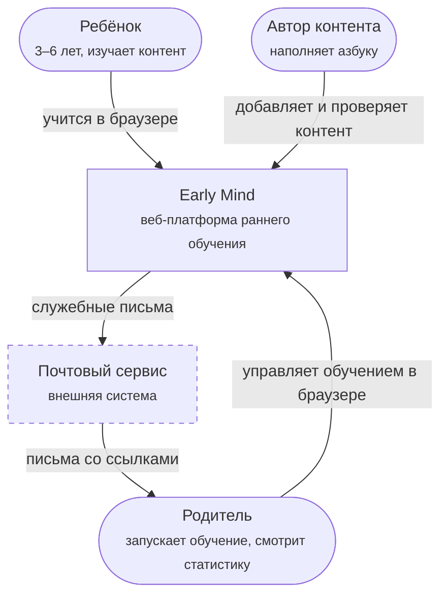
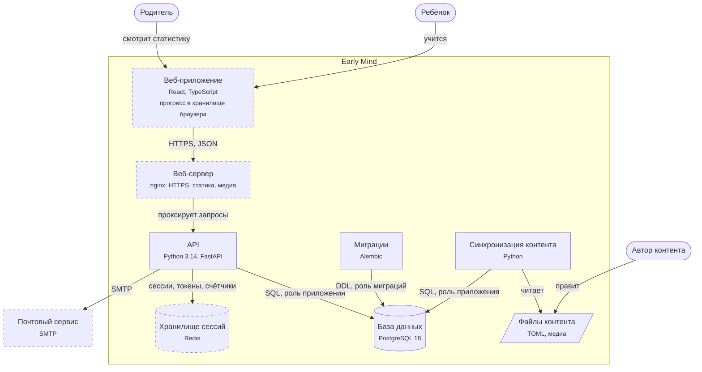

# Архитектура: модель C4

Архитектура описана по модели [C4](https://c4model.com/) на двух уровнях: контекст системы и контейнеры. Пунктирная рамка — элемент планируется, сплошная — реализован.

## Уровень 1. Контекст



| Элемент | Описание |
|---|---|
| Ребёнок | Изучает контент: карточки букв, обучение по порядку, проверочные задания |
| Родитель | Запускает обучение, смотрит статистику и историю занятий |
| Автор контента | Добавляет буквы, слова и медиа в файлы контента и проверяет их автоматическими тестами |
| Почтовый сервис | Внешняя система: доставляет письма подтверждения email и сброса пароля |

Во время работы система зависит только от почтового сервиса: через него уходят письма подтверждения email и сброса пароля. Контент и аккаунты хранятся в собственной БД, прогресс — на устройстве.

## Уровень 2. Контейнеры



| Контейнер | Назначение | Технологии | Статус |
|---|---|---|---|
| Веб-приложение | Интерфейс ребёнка и родителя. Хранит прогресс, статистику и историю сессий в хранилище браузера, отправляет обезличенные события аналитики | React, TypeScript | Планируется |
| Веб-сервер | Отдаёт веб-приложение и медиафайлы, завершает HTTPS, проксирует запросы к API | nginx | Планируется |
| API | Отдаёт контент азбуки и проверки работоспособности по REST, принимает события аналитики. Регистрация и вход родителя — [проектирование](auth.md) | Python 3.14, FastAPI, SQLAlchemy 2 | Реализовано, аккаунт планируется |
| База данных | Хранит контент — алфавиты, буквы, слова — и события аналитики, а также аккаунты родителей и согласия | PostgreSQL 18 | Реализовано, аккаунты планируются |
| Хранилище сессий | Сессии, токены ссылок из писем и счётчики ограничения частоты со сроком жизни | Redis | Планируется |
| Почтовый сервис | Внешняя система: в разработке Mailpit в Docker, в работе — SMTP-провайдер с серверами в России | SMTP | Планируется |
| Миграции | Создают и изменяют схему БД под отдельной ролью | Alembic | Реализовано |
| Синхронизация контента | Загружает файлы контента в БД, повторный запуск безопасен | Python, SQLAlchemy 2 | Реализовано |
| Файлы контента | Источник правды для контента: буквы и слова в TOML, позже звуки и иллюстрации | TOML | Реализовано для букв и слов |

## Роли базы данных

| Роль | Права | Кто использует |
|---|---|---|
| `early_mind_app` | Чтение, добавление, изменение и удаление строк. Изменять схему не может | API, синхронизация контента |
| `early_mind_migrator` | Владелец таблиц, создаёт и изменяет схему | Миграции |

Права проверяются интеграционными тестами.

## Интерфейсы API

Полная спецификация OpenAPI доступна в Swagger UI по адресу `/docs` и в файле [openapi.json](../api/openapi.json). Документация API опубликована на [GitHub Pages](https://nsat1.github.io/early-mind/api/).

| Метод и путь | Назначение | Ответы |
|---|---|---|
| `GET /health` | Процесс API работает | 200 |
| `GET /health/ready` | API готов принимать запросы: БД доступна | 200, 503 |
| `GET /api/v1/alphabets/{alphabet_id}/letters` | Список букв алфавита в порядке позиции. Необязательный фильтр по виду: `?kind=vowel`, `consonant` или `sign` | 200, 404, 422, 503 |
| `GET /api/v1/alphabets/{alphabet_id}/letters/{code}` | Буква со словами-примерами | 200, 404, 422, 503 |
| `POST /api/v1/analytics/events` | Приём пачки до 50 событий по каталогу аналитики | 202, 422, 503 |
| `GET /media/{alphabet_id}/{path}` | Звуки и иллюстрации азбуки. Адреса с версией приходят в ответе о букве. Локально файлы отдаёт API, в работе — nginx | 200, 206, 404 |

Эндпоинты аккаунта родителя `/api/v1/auth/…` и `/api/v1/account…` описаны в [проектировании аккаунта](auth.md).

Ошибки возвращаются в формате Problem Details ([RFC 9457](https://www.rfc-editor.org/rfc/rfc9457)) с типом содержимого `application/problem+json`. Если БД недоступна, любой эндпоинт отвечает 503. Пример ответа на неверный параметр:

```json
{
  "type": "about:blank",
  "title": "Unprocessable Content",
  "status": 422,
  "detail": "Request parameters are invalid",
  "instance": "/api/v1/alphabets/ru/letters",
  "errors": [{"in": "query", "name": "kind", "detail": "Input should be 'vowel', 'consonant' or 'sign'"}]
}
```

## Требования к выкладке

- nginx ограничивает частоту запросов и размер тела для `/api/v1/analytics/`: эндпоинт открыт без аутентификации.
- IP-адреса не попадают в журналы: для `/api/v1/analytics/` nginx пишет журнал без `$remote_addr`, журнал доступа uvicorn выключен.
- Задание по расписанию удаляет события аналитики старше 12 месяцев.
- nginx передаёт адрес клиента в `X-Forwarded-For`, API доверяет этому заголовку только от nginx: адрес нужен для ограничения частоты запросов к аккаунту и в журналы не попадает.
- Redis доступен только API во внутренней сети Docker, наружу порт не открыт.
- nginx отдаёт `/media/` из `content/alphabets/` только для файлов `.mp3`, `.webp`, `.svg`, с долгим кэшем: адреса содержат версию файла. Для SVG — заголовок `Content-Security-Policy` без скриптов.
