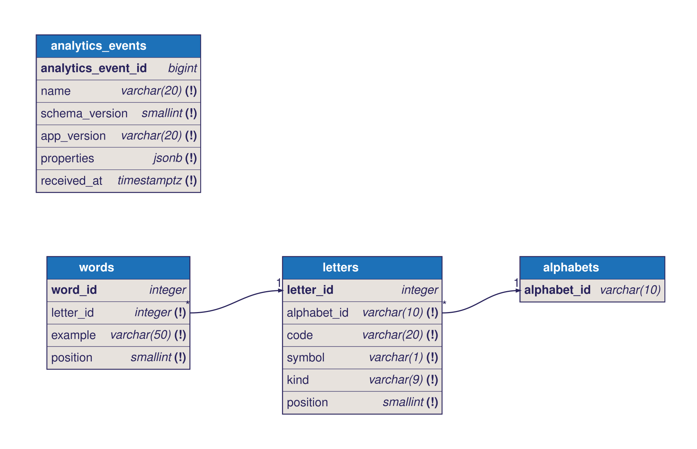

# Модель данных

## ER-диаграмма

Исходник диаграммы — [schema.dbml](schema.dbml). Стрелка ведёт от внешнего ключа к первичному: `letters.alphabet_id` → `alphabets.alphabet_id`, `words.letter_id` → `letters.letter_id`. `*` — много записей, `1` — одна запись, `(!)` — обязательное поле.

## Словарь данных

### alphabets — алфавиты

| Поле | Тип | Обязательное | Ограничения | Описание |
|---|---|---|---|---|
| `alphabet_id` | `VARCHAR(10)` | Да | Первичный ключ `pk_alphabets` | Код алфавита — код языка по ISO 639-1, например `ru`. Используется в API |

### letters — буквы

| Поле | Тип | Обязательное | Ограничения | Описание |
|---|---|---|---|---|
| `letter_id` | `INTEGER`, `GENERATED ALWAYS AS IDENTITY` | Да | Первичный ключ `pk_letters` | Внутренний идентификатор, в API не передаётся |
| `alphabet_id` | `VARCHAR(10)` | Да | Внешний ключ `fk_letters_alphabet_id_alphabets` на `alphabets.alphabet_id`, каскадное удаление | Алфавит, к которому относится буква |
| `code` | `VARCHAR(20)` | Да | Уникален в алфавите: `uq_letters_alphabet_id_code` | Код буквы латиницей для API, например `a`, `zh` |
| `symbol` | `VARCHAR(1)` | Да | — | Заглавная буква, например `А` |
| `kind` | `VARCHAR(9)` | Да | `ck_letters_kind`: `vowel`, `consonant` или `sign` | Вид буквы: гласная, согласная или знак |
| `position` | `SMALLINT` | Да | `ck_letters_position_positive`: больше 0. Уникальна в алфавите: `uq_letters_alphabet_id_position` | Позиция буквы в алфавите, начиная с 1 |
| `sound` | `VARCHAR(111)` | Нет | — | Звук буквы, у Ъ и Ь — название знака. Путь к файлу относительно папки алфавита с версией по содержимому, например `letters/m.mp3?v=3fa2c1d4`. Пусто, если файла нет |
| `image` | `VARCHAR(111)` | Нет | — | Картинка буквы с заглавной и строчной буквой, одна для списка и карточки. Путь к файлу относительно папки алфавита с версией по содержимому, например `letters/m.webp?v=9d41b7e2`. Пусто, если файла нет |

### words — слова-примеры

| Поле | Тип | Обязательное | Ограничения | Описание |
|---|---|---|---|---|
| `word_id` | `INTEGER`, `GENERATED ALWAYS AS IDENTITY` | Да | Первичный ключ `pk_words` | Внутренний идентификатор |
| `letter_id` | `INTEGER` | Да | Внешний ключ `fk_words_letter_id_letters` на `letters.letter_id`, каскадное удаление | Буква, которую иллюстрирует слово |
| `example` | `VARCHAR(50)` | Да | — | Слово-пример строчными буквами, например `арбуз` |
| `position` | `SMALLINT` | Да | `ck_words_position_positive`: больше 0. Уникальна для буквы: `uq_words_letter_id_position` | Порядок слова в карточке буквы |
| `image` | `VARCHAR(111)` | Нет | — | Иллюстрация слова. Путь к файлу относительно папки алфавита с версией по содержимому, например `words/medved.webp?v=5b9e0a17`. Пусто, если файла нет |
| `sound` | `VARCHAR(111)` | Нет | — | Озвучка слова. Путь к файлу относительно папки алфавита с версией по содержимому, например `words/medved.mp3?v=8c2d4f60`. Пусто, если файла нет |

### analytics_events — события аналитики

| Поле | Тип | Обязательное | Ограничения | Описание |
|---|---|---|---|---|
| `analytics_event_id` | `BIGINT`, `GENERATED ALWAYS AS IDENTITY` | Да | Первичный ключ `pk_analytics_events` | Внутренний идентификатор, в API не передаётся |
| `name` | `VARCHAR(20)` | Да | `ck_analytics_events_name`: `app_opened`, `session_finished` или `answer_given` | Имя события из [каталога аналитики](../requirements/analytics.md) |
| `schema_version` | `SMALLINT` | Да | `ck_analytics_events_schema_version_positive`: больше 0 | Версия схемы полей события |
| `app_version` | `VARCHAR(20)` | Да | — | Версия веб-приложения, отправившего событие |
| `properties` | `JSONB` | Да | Проверяются API по каталогу | Поля события |
| `received_at` | `TIMESTAMPTZ` | Да | По умолчанию `date_trunc('hour', now())` | Время получения, округлённое до часа |

Индекс `ix_analytics_events_name_received_at` по `(name, received_at)` ускоряет расчёт метрик и удаление старых событий.

Служебная таблица `alembic_version` хранит номер последней применённой миграции.

## Представления метрик

Формулы метрик описаны в [каталоге аналитики](../requirements/analytics.md). Неделя — понедельник по московскому времени.

### analytics_weekly_sessions — сессии по неделям

| Поле | Тип | Описание |
|---|---|---|
| `week` | `DATE` | Неделя |
| `sessions` | `BIGINT` | Число сессий |
| `completed_sessions` | `BIGINT` | Число сессий хотя бы с одним ответом |
| `median_duration_seconds` | `DOUBLE PRECISION` | Медиана длительности сессии |
| `healthy_duration_share` | `NUMERIC` | Доля сессий длительностью от 5 до 10 минут |
| `median_strong_letters` | `DOUBLE PRECISION` | Медиана числа сильных букв на устройстве |

### analytics_letter_accuracy — точность по буквам

| Поле | Тип | Описание |
|---|---|---|
| `week` | `DATE` | Неделя |
| `alphabet_id` | `TEXT` | Алфавит |
| `letter_code` | `TEXT` | Код буквы |
| `task_type` | `TEXT` | Тип задания: `sound` или `picture` |
| `answers` | `BIGINT` | Число ответов |
| `correct_answers` | `BIGINT` | Число верных ответов |
| `accuracy` | `NUMERIC` | Доля верных ответов |

### analytics_retention — возврат по когортам

| Поле | Тип | Описание |
|---|---|---|
| `first_visit_week` | `TEXT` | Неделя первого визита по ISO 8601 |
| `new_devices` | `BIGINT` | Число устройств когорты |
| `returned_devices` | `BIGINT` | Число устройств, открывших приложение через 7–13 дней |
| `return_rate` | `NUMERIC` | Доля вернувшихся. Пусто, если новых устройств нет |

## Где хранятся данные релиза 1

| Данные | Где хранятся | Источник правды |
|---|---|---|
| Алфавиты, буквы, слова | PostgreSQL | Файлы контента в `content/alphabets`, переносятся в БД синхронизацией |
| Изученные буквы, статистика букв, история сессий | Хранилище браузера на устройстве | Веб-приложение |
| Медиафайлы: звуки и иллюстрации | Файлы рядом с файлом контента в `content/alphabets/<алфавит>/`, в БД только пути | Файлы контента |
| События аналитики | PostgreSQL, 12 месяцев | Веб-приложение отправляет их в API |

## Планируемые изменения

- Контент: звуки букв и названия Ъ и Ь, иллюстрации и озвучка слов.
- Релиз 2: аккаунты родителей, профили детей и прогресс на сервере.
