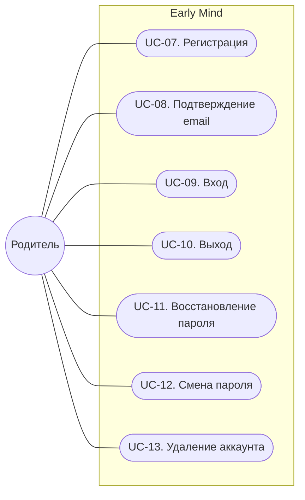

# Аккаунт родителя

Связанные документы: [сценарии использования](use-cases.md), [бизнес-правила](business-rules.md), [функциональные требования](functional-requirements.md), [нефункциональные требования](non-functional-requirements.md).

Азбука доступна без регистрации. Аккаунт нужен родителю для экрана родителя: статистики, истории занятий и управления аккаунтом. Прогресс в этом релизе хранится на устройстве, перенос на сервер — следующий этап.

## Акторы

| Актор | Описание |
|---|---|
| Родитель | Регистрирует аккаунт, входит и управляет им |

## Диаграмма

## Сводка

| ID | Сценарий | Основной актор | Приоритет |
|---|---|---|---|
| UC-07 | Регистрация | Родитель | Must |
| UC-08 | Подтверждение email | Родитель | Must |
| UC-09 | Вход | Родитель | Must |
| UC-10 | Выход | Родитель | Must |
| UC-11 | Восстановление пароля | Родитель | Must |
| UC-12 | Смена пароля | Родитель | Should |
| UC-13 | Удаление аккаунта | Родитель | Must |

## UC-07. Регистрация

**Актор:** Родитель.
**Цель:** создать аккаунт.
**Предусловие:** родитель не вошёл.

**Основной сценарий:**

1. Родитель открывает страницу регистрации со страницы входа.
2. Родитель вводит email и пароль, отмечает согласие на обработку персональных данных и подтверждает, что ему есть 18 лет (FR-40, FR-50, BR-12, BR-20).
3. Система проверяет пароль (BR-13) и создаёт неподтверждённый аккаунт (BR-11).
4. Система отправляет письмо со ссылкой подтверждения и показывает «Проверьте почту» (FR-41, BR-14).

**Альтернативные сценарии:**

- 3а. Пароль не соответствует правилам: система объясняет, что не так. Переход к шагу 2.
- 3б. Email уже зарегистрирован: система показывает тот же экран «Проверьте почту», а на email отправляет письмо о том, что аккаунт уже есть, со ссылками на вход и восстановление пароля (BR-19).

**Постусловие:** создан неподтверждённый аккаунт, письмо отправлено.

## UC-08. Подтверждение email

**Актор:** Родитель.
**Цель:** подтвердить, что email принадлежит родителю.
**Предусловие:** аккаунт создан, письмо получено.

**Основной сценарий:**

1. Родитель открывает ссылку из письма.
2. Система подтверждает email, делает ссылку недействительной и предлагает войти (FR-42, BR-14).

**Альтернативные сценарии:**

- 2а. Ссылка устарела или уже использована: система предлагает отправить новую (FR-41).

**Постусловие:** email подтверждён.

## UC-09. Вход

**Актор:** Родитель.
**Цель:** открыть экран родителя.
**Предусловие:** нет.

**Основной сценарий:**

1. Родитель нажимает «Для родителя» на главной странице, система показывает страницу входа (FR-38, FR-49).
2. Родитель вводит email и пароль (FR-43).
3. Система проверяет данные, создаёт новую сессию и открывает экран родителя (BR-15).

**Альтернативные сценарии:**

- 1а. Сессия уже действует: система сразу открывает экран родителя.
- 3а. Email или пароль неверны: система показывает «Неверный email или пароль», не уточняя, что именно (BR-19). Переход к шагу 2.
- 3б. Пароль верный, но email не подтверждён: система предлагает отправить письмо повторно (FR-41, BR-14).
- 3в. Слишком много неудачных попыток: система сообщает, что вход временно приостановлен, и предлагает восстановить пароль (BR-17).

**Постусловие:** родитель вошёл, создана сессия.

## UC-10. Выход

**Актор:** Родитель.
**Цель:** завершить работу на устройстве.
**Предусловие:** родитель вошёл.

**Основной сценарий:**

1. Родитель на экране родителя нажимает «Выйти» (FR-44, FR-51).
2. Система завершает текущую сессию и показывает страницу входа.

**Альтернативные сценарии:**

- 1а. Родитель нажимает «Выйти на всех устройствах»: система завершает все сессии аккаунта (FR-45).

**Постусловие:** сессия завершена.

## UC-11. Восстановление пароля

**Актор:** Родитель.
**Цель:** войти, если пароль забыт.
**Предусловие:** родитель не вошёл.

**Основной сценарий:**

1. Родитель на странице входа нажимает «Забыли пароль?» и вводит email (FR-46).
2. Система показывает «Если аккаунт есть, мы отправили письмо» и отправляет письмо со ссылкой сброса пароля (BR-16, BR-19).
3. Родитель открывает ссылку и вводит новый пароль (BR-13).
4. Система меняет пароль, делает ссылку недействительной, завершает все сессии аккаунта и предлагает войти (BR-16, BR-18).

**Альтернативные сценарии:**

- 2а. Аккаунта с таким email нет: система показывает то же сообщение, письмо не отправляется (BR-19).
- 3а. Ссылка устарела или уже использована: система предлагает запросить новую.

**Постусловие:** пароль изменён, все сессии завершены.

## UC-12. Смена пароля

**Актор:** Родитель.
**Цель:** заменить пароль на новый.
**Предусловие:** родитель вошёл.

**Основной сценарий:**

1. Родитель на экране родителя выбирает «Сменить пароль», вводит текущий и новый пароль (FR-47, FR-51).
2. Система проверяет текущий пароль и правила нового (BR-13), меняет пароль и завершает остальные сессии (BR-18).

**Альтернативные сценарии:**

- 2а. Текущий пароль неверный: система сообщает об ошибке, пароль не меняется.

**Постусловие:** пароль изменён, сессии на других устройствах завершены.

## UC-13. Удаление аккаунта

**Актор:** Родитель.
**Цель:** удалить аккаунт и свои данные.
**Предусловие:** родитель вошёл.

**Основной сценарий:**

1. Родитель на экране родителя выбирает «Удалить аккаунт» (FR-51).
2. Система предупреждает, что данные удалятся безвозвратно, и просит ввести пароль (FR-48).
3. Родитель вводит пароль и подтверждает удаление.
4. Система удаляет аккаунт и связанные данные, завершает все сессии и показывает страницу входа (BR-21).

**Альтернативные сценарии:**

- 3а. Пароль неверный: система сообщает об ошибке, аккаунт не удаляется.

**Постусловие:** аккаунт и данные удалены.

## Бизнес-правила

| ID | Правило |
|---|---|
| BR-11 | Аккаунт принадлежит родителю: один email — один аккаунт. Email сравнивается без учёта регистра |
| BR-12 | Зарегистрироваться может только совершеннолетний: при регистрации родитель подтверждает, что ему есть 18 лет |
| BR-13 | Пароль — от 8 до 64 символов, допустимы любые символы, включая пробелы и кириллицу. Требований к составу нет. Пароль не должен входить в список самых частых паролей и совпадать с email. Принудительной периодической смены нет |
| BR-14 | Войти можно только с подтверждённым email. Ссылка подтверждения действует 24 часа и только один раз, новая ссылка отменяет прежнюю |
| BR-15 | Сессия действует 30 дней с последнего действия, но не дольше 90 дней с момента входа. Каждый вход создаёт новую сессию |
| BR-16 | Ссылка сброса пароля действует 1 час и только один раз, новая ссылка отменяет прежнюю. Сброс пароля по ссылке подтверждает email |
| BR-17 | После 5 неудачных попыток входа с одним email за 15 минут вход по паролю для этого email приостанавливается на 15 минут. Правило работает одинаково для существующих и несуществующих email. Восстановление пароля при этом доступно |
| BR-18 | Смена пароля завершает все сессии, кроме текущей. Сброс пароля по ссылке завершает все сессии |
| BR-19 | Ответы при регистрации, входе и восстановлении пароля не раскрывают, зарегистрирован ли email: тексты одинаковы для существующих и несуществующих email. Неподтверждённый email система сообщает только после верного пароля |
| BR-20 | Согласие на обработку персональных данных даётся отдельной отметкой при регистрации и не входит в другие документы. Система хранит, какую версию политики принял родитель и когда |
| BR-21 | Удаление аккаунта безвозвратно: аккаунт, согласие и сессии удаляются сразу, из резервных копий данные исчезают по истечении срока их хранения (NFR-09) |

## Функциональные требования

| ID | Требование | Приоритет | Связь |
|---|---|---|---|
| FR-40 | Система должна регистрировать аккаунт по email и паролю, только если родитель дал согласие на обработку персональных данных и подтвердил, что ему есть 18 лет | Must | UC-07, BR-11, BR-12, BR-13, BR-20 |
| FR-41 | Система должна отправлять письмо со ссылкой подтверждения email после регистрации и по запросу повторной отправки | Must | UC-07, UC-08, UC-09, BR-14 |
| FR-42 | Система должна подтверждать email по ссылке из письма | Must | UC-08, BR-14 |
| FR-43 | Система должна выполнять вход по email и паролю | Must | UC-09, BR-14, BR-15, BR-17, BR-19 |
| FR-44 | Система должна завершать текущую сессию по кнопке «Выйти» | Must | UC-10 |
| FR-45 | Система должна завершать все сессии аккаунта по кнопке «Выйти на всех устройствах» | Should | UC-10 |
| FR-46 | Система должна восстанавливать пароль по ссылке из письма | Must | UC-11, BR-16, BR-18, BR-19 |
| FR-47 | Система должна менять пароль после ввода текущего | Should | UC-12, BR-13, BR-18 |
| FR-48 | Система должна удалять аккаунт со всеми данными после подтверждения паролем | Must | UC-13, BR-21 |
| FR-49 | Система должна без входа показывать главную страницу, раздел «Алфавит» и страницы входа, регистрации, подтверждения email, восстановления пароля и политики обработки персональных данных, а экран родителя — только после входа, перенаправляя на страницу входа | Must | UC-05, UC-09 |
| FR-50 | Система должна показывать политику обработки персональных данных до регистрации | Must | UC-07, BR-20 |
| FR-51 | Система должна показывать на экране родителя email аккаунта и действия: сменить пароль, выйти, выйти на всех устройствах, удалить аккаунт | Must | UC-10, UC-12, UC-13 |

## Персональные данные (152-ФЗ)

| Данные | Персональные | Зачем | Срок хранения |
|---|---|---|---|
| Email | Да | Вход, служебные письма | До удаления аккаунта |
| Хеш пароля | Нет, сам пароль не хранится (NFR-16) | Проверка пароля | До удаления аккаунта или смены пароля |
| Согласие: версия политики и время | Связано с аккаунтом | Подтверждение согласия | До удаления аккаунта |
| Сессии | Связаны с аккаунтом | Доступ к аккаунту | До выхода, не дольше 90 дней (BR-15) |
| Одноразовые ссылки | Связаны с аккаунтом | Подтверждение email, сброс пароля | 24 часа и 1 час (BR-14, BR-16) |
| Счётчики неудачных входов | Нет | Защита от подбора пароля | 15 минут (BR-17) |

- О ребёнке в этом релизе не хранится ничего. Прогресс остаётся на устройстве, события аналитики обезличены и не связываются с аккаунтом.
- Основание обработки — согласие родителя (ст. 6, 9). Согласие оформляется отдельно от других документов, его можно отозвать, удалив аккаунт (UC-13).
- Политика обработки персональных данных опубликована и доступна до регистрации (ст. 18.1, FR-50).
- Данные хранятся на серверах в России (ст. 18, ч. 5, NFR-19).
- Служебные письма отправляет почтовый сервис по поручению оператора (ст. 6, ч. 3); сервис с серверами в России выбирается при выкладке.
- До публичного запуска: юридическая проверка политики и согласия, уведомление Роскомнадзора об обработке персональных данных (ст. 22).
